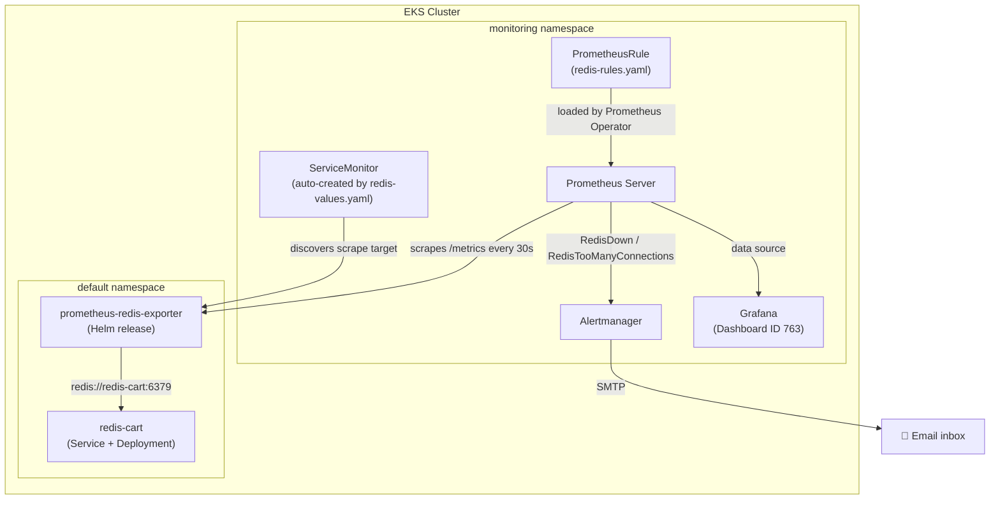
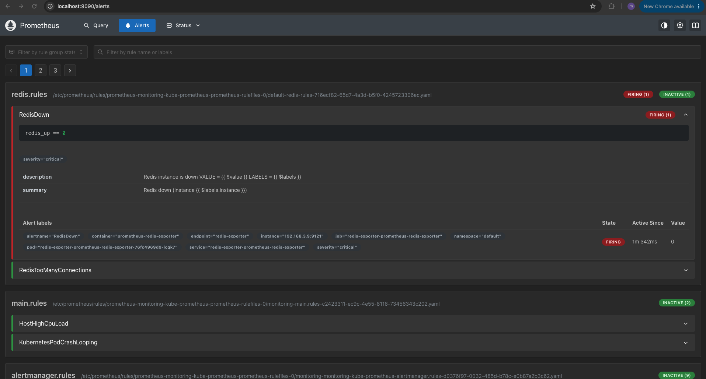
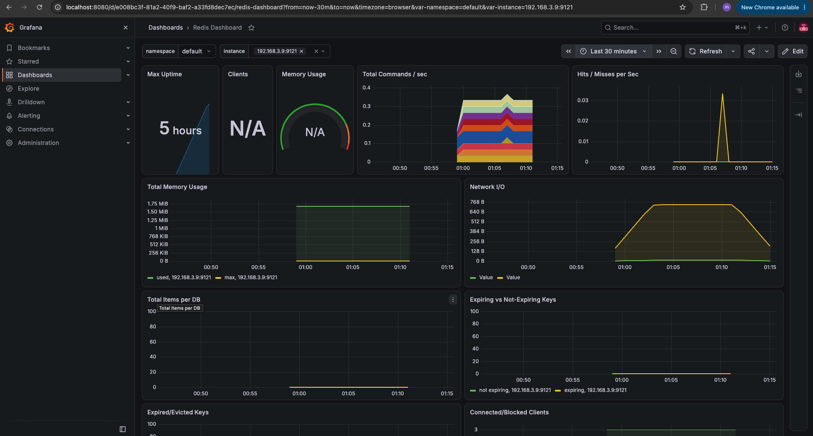

# � Prometheus Configure Monitoring for a Third-Party Application


**Prometheus** is an open-source monitoring and alerting toolkit that collects metrics from configured targets at regular intervals, stores them as time series data, and lets you query, visualize, and alert on them using its own query language, **PromQL**. *(Source: [prometheus.io docs](https://prometheus.io/docs/introduction/overview/))*

## 🔭 Overview

Not every application natively exposes Prometheus-compatible metrics — **Redis** is a prime example. This project demonstrates how to bring a third-party, closed-box application under full observability by deploying a dedicated **exporter**, registering it with the Prometheus Operator via a `ServiceMonitor`, defining alerting rules tailored to Redis failure modes, and importing a community-built Grafana dashboard. This pattern — exporter + ServiceMonitor + PrometheusRule + Grafana dashboard — generalizes to monitoring *any* third-party service (databases, message queues, proxies, etc.) running in Kubernetes.

### 📈 Prometheus Monitoring

Prometheus can only scrape metrics exposed in its own [text-based exposition format](https://prometheus.io/docs/instrumenting/exposition_formats/) over HTTP. Applications that don't speak this format natively (like Redis, MySQL, or Nginx) are monitored using an **exporter**: a small sidecar/companion process that connects to the target application, translates its internal statistics into Prometheus metrics, and exposes them on a `/metrics` endpoint for Prometheus to scrape.

In a Prometheus Operator-managed cluster, the discovery of these exporter endpoints is itself declarative:

- 📤 **Exporter** – translates an application's native metrics/protocol into the Prometheus exposition format (e.g. the official [Redis Exporter](https://github.com/oliver006/redis_exporter)).
- 🎯 **ServiceMonitor** – a Prometheus Operator CRD that tells Prometheus *which* Kubernetes `Service` to scrape, on *which* port, and at *what* interval — eliminating any manual edits to `prometheus.yml`.
- 🚨 **PrometheusRule** – declares alerting conditions specific to the third-party application (e.g. "instance is down", "too many connections").
- 📊 **Grafana Dashboard** – a pre-built or custom visualization layer that turns the exporter's raw metrics into actionable panels.

## 🎯 Demo Project

Prometheus Configure Monitoring for a Third-Party Application

## 🛠️ Technologies used

- Prometheus
- Kubernetes
- Redis
- Helm
- Grafana

## 📝 Project Description

- Monitor Redis by using Prometheus Exporter
- Deploy Redis service in our cluster
- Deploy Redis exporter using Helm Chart
- Configure Alert Rules (when Redis is down or has too many connections)
- Import Grafana Dashboard for Redis to visualize monitoring data in Grafana

## 📁 Repository structure

```
prometheus-configure-monitoring-for-a-third-party-application/
├── README.md                          # This documentation file
├── NOTES.md                           # Raw working notes taken during the implementation
├── config-microservices.yaml          # Kubernetes manifests for the "Online Boutique" demo app (includes Redis)
├── redis-values.yaml                  # Helm values enabling the ServiceMonitor for the Redis exporter chart
├── redis-rules.yaml                   # PrometheusRule CRD - RedisDown & RedisTooManyConnections alerts
├── alert-rules.yaml                   # PrometheusRule CRD - general host/pod alerts (HostHighCpuLoad, KubernetesPodCrashLooping)
├── alert-manager-configuration.yaml   # AlertmanagerConfig CRD - routes alerts to the email receiver
├── email-secret.yaml                  # Kubernetes Secret holding the SMTP app-password (placeholder value)
├── .gitignore
└── images/                            # Screenshots captured from cloud console, terminal & browser
    ├── prometheus-ui-redis-alert-browser.png
    └── grafana-redis-dashboard-browser.png
```

## 🏗️ Architecture overview



The **Redis Exporter** runs as its own Helm release, independent of the application it monitors. It connects to `redis-cart` over the standard Redis protocol, and exposes translated metrics (`redis_up`, `redis_connected_clients`, `redis_memory_used_bytes`, etc.) on an HTTP `/metrics` endpoint, which Prometheus discovers automatically through the chart's self-registering `ServiceMonitor`.

## 🚀 Implementation Guide

### 1. Prerequisites

This project assumes the monitoring stack from [Install Prometheus Stack in Kubernetes](https://github.com/mustafa-saleh/install-prometheus-stack-in-kubernetes) & [Prometheus Alerts](https://github.com/mustafa-saleh/prometheus-configure-alerting-for-our-application) is already up and running, with the Online Boutique demo app (which includes a `redis-cart` deployment) deployed via [config-microservices.yaml](config-microservices.yaml). Make sure you have:

- A running **AWS EKS cluster** with the **kube-prometheus-stack** Helm chart installed in the `monitoring` namespace (Prometheus Operator, Prometheus server, Alertmanager, Grafana).
- A `redis-cart` **Service** already running in the cluster (deployed as part of the Online Boutique microservices demo).
- [**kubectl**](https://kubernetes.io/docs/tasks/tools/) configured to talk to the cluster.
- [**Helm**](https://helm.sh/docs/intro/install/) – used to install the Redis Exporter chart.

Verify Redis is reachable and the monitoring namespace is healthy:

```bash
kubectl get pod
kubectl get all -n monitoring
```

### 2. Understand how third-party monitoring works

Before installing anything, it helps to confirm what visibility is currently missing. The Prometheus Operator discovers scrape targets exclusively through `ServiceMonitor` resources — list the ones currently registered to see that Redis isn't monitored yet:

```bash
kubectl get servicemonitors -n monitoring
```

Since Redis doesn't expose Prometheus-formatted metrics out of the box, a dedicated [**Redis Exporter**](https://github.com/prometheus-community/helm-charts/tree/main/charts/prometheus-redis-exporter) needs to be deployed alongside it, translating Redis's `INFO` command output into scrape-able metrics.

### 3. Deploy the Redis Exporter via Helm

[redis-values.yaml](redis-values.yaml) customizes the official `prometheus-redis-exporter` chart to point at the existing `redis-cart` service and to automatically create a `ServiceMonitor` labeled so the Prometheus Operator picks it up:

```yaml
serviceMonitor:
  enabled: true
  labels:
    release: monitoring

redisAddress: redis://redis-cart:6379
```

- `serviceMonitor.enabled: true` – has the chart create the `ServiceMonitor` resource for us, instead of writing one by hand.
- `labels.release: monitoring` – matches the Prometheus Operator's `serviceMonitorSelector`, which is what makes it pick up this target (this label is set by the `kube-prometheus-stack` release named `monitoring`).
- `redisAddress` – the Redis connection string the exporter authenticates against, pointing at the in-cluster `redis-cart` ClusterIP service.

Add the Helm repository and install the chart:

```bash
helm repo add prometheus-community https://prometheus-community.github.io/helm-charts
helm repo update
helm install redis-exporter prometheus-community/prometheus-redis-exporter -f redis-values.yaml
```

Confirm the exporter pod is running and the `ServiceMonitor` was created:

```bash
kubectl get pod
kubectl get servicemonitor
```

In the Prometheus UI, open the **Targets** tab to confirm the Redis exporter endpoint is being successfully scraped, and use the **Graph** tab to search for `redis_up`, `redis_connected_clients`, or `redis_memory_used_bytes` to confirm metrics are flowing in.

### 4. Configure Alert Rules for Redis

With metrics now available, Redis-specific failure conditions can be codified as a `PrometheusRule`. Rather than writing PromQL expressions from scratch, the community-curated [Awesome Prometheus Alerts](https://samber.github.io/awesome-prometheus-alerts/) catalog was used as the starting point for these rules. [redis-rules.yaml](redis-rules.yaml):

```yaml
apiVersion: monitoring.coreos.com/v1
kind: PrometheusRule
metadata:
  name: redis-rules
  labels:
    app: kube-prometheus-stack
    release: monitoring 
spec:
  groups:
  - name: redis.rules
    rules:
    - alert: RedisDown
      expr: redis_up == 0
      for: 0m
      labels:
        severity: critical
      annotations:
        summary: Redis down (instance {{ $labels.instance }})
        description: "Redis instance is down\n  VALUE = {{ $value }}\n  LABELS = {{ $labels }}"
    - alert: RedisTooManyConnections
      expr: redis_connected_clients / redis_config_maxclients * 100 > 90
      for: 2m
      labels:
        severity: warning
      annotations:
        summary: Redis too many connections (instance {{ $labels.instance }})
        description: "Redis has {{ $value }} connections\n  LABELS = {{ $labels }}"
```

- **`RedisDown`** – fires **immediately** (`for: 0m`) whenever the exporter reports `redis_up == 0`, meaning it can no longer establish a connection to the Redis instance.
- **`RedisTooManyConnections`** – fires as a **warning** when connected clients exceed **90%** of `maxclients` for at least 2 minutes, flagging potential connection-pool exhaustion before it becomes an outage.

Apply the rules and confirm they're registered:

```bash
kubectl apply -f redis-rules.yaml
kubectl get prometheusrules 
```

### 5. Trigger the `RedisDown` alert under real conditions

To validate the alert fires correctly (not just that it's syntactically valid), Redis availability was deliberately disrupted by scaling its deployment down to zero replicas:

```bash
# set replicas to 0 to simulate Redis down
kubectl edit deployment redis-cart
kubectl get pod
```

According to the [chart's scrape interval configuration](https://github.com/prometheus-community/helm-charts/blob/main/charts/prometheus-redis-exporter/values.yaml), Prometheus detects the outage within **30 seconds**. Shortly after, the Prometheus **Alerts** tab shows `RedisDown` transitioning to **FIRING**, correctly scoped under its own `redis.rules` group alongside the unrelated `main.rules` alerts:



Because this cluster's Alertmanager is already wired up with an email receiver (see [Prometheus Configure Alerting for our Application](../prometheus-configure-alerting-for-our-application)), the firing `RedisDown` alert is automatically routed and delivered to the configured inbox — no additional Alertmanager configuration is required for new `PrometheusRule` resources, since routing is based on alert labels rather than rule source files.

### 6. Import the Grafana Dashboard for Redis

Rather than hand-building panels for every exporter metric, [Grafana Labs](https://grafana.com/grafana/dashboards/) hosts a large catalog of pre-built, community-maintained dashboards. The official [**Redis Dashboard for Prometheus Redis Exporter**](https://grafana.com/grafana/dashboards/763-redis-dashboard-for-prometheus-redis-exporter-1-x/) (ID `763`) was imported to visualize the exporter's metrics:

1. Open the Grafana UI and click the **+** icon on the left sidebar, then select **Import**.
2. Enter dashboard ID **`763`** and click **Load**.
3. Select the **Prometheus** data source provisioned by the `kube-prometheus-stack` chart, then click **Import**.

The resulting dashboard surfaces Redis health and performance at a glance — uptime, connected clients, memory usage, commands/sec, hit/miss ratio, network I/O, and expiring vs. non-expiring keys — all sourced directly from the exporter's metrics:



## 🏁 Final result

By the end of this demo, a previously unmonitored third-party dependency (Redis) is fully integrated into the existing observability stack:

- ✅ The **Redis Exporter** deployed via Helm, translating Redis internals into Prometheus-compatible metrics.
- ✅ A self-registering **ServiceMonitor** automatically discovered by the Prometheus Operator — no manual `prometheus.yml` edits.
- ✅ Two Redis-specific alert rules (`RedisDown`, `RedisTooManyConnections`) deployed declaratively via `PrometheusRule`.
- ✅ The `RedisDown` alert validated end-to-end by deliberately scaling Redis to zero replicas and confirming it fires within the expected scrape interval.
- ✅ A production-grade, community-maintained **Grafana dashboard** (ID 763) imported to visualize Redis health in real time.

This same exporter → ServiceMonitor → PrometheusRule → Grafana dashboard pattern can be repeated to onboard virtually any third-party application (MySQL, Nginx, RabbitMQ, etc.) onto the monitoring stack with minimal custom code.

## 📚 References

- [Prometheus Exporters and Integrations](https://prometheus.io/docs/instrumenting/exporters/)
- [Redis Exporter Helm Chart (prometheus-community)](https://github.com/prometheus-community/helm-charts/tree/main/charts/prometheus-redis-exporter)
- [Official Redis Exporter Project](https://github.com/oliver006/redis_exporter)
- [Awesome Prometheus Alerts – Redis Rules](https://samber.github.io/awesome-prometheus-alerts/rules.html#redis)
- [Grafana Labs – Redis Dashboard for Prometheus Redis Exporter (ID 763)](https://grafana.com/grafana/dashboards/763-redis-dashboard-for-prometheus-redis-exporter-1-x/)
- [Prometheus Operator – ServiceMonitor API Reference](https://prometheus-operator.dev/docs/api-reference/api/#monitoring.coreos.com/v1.ServiceMonitor)
